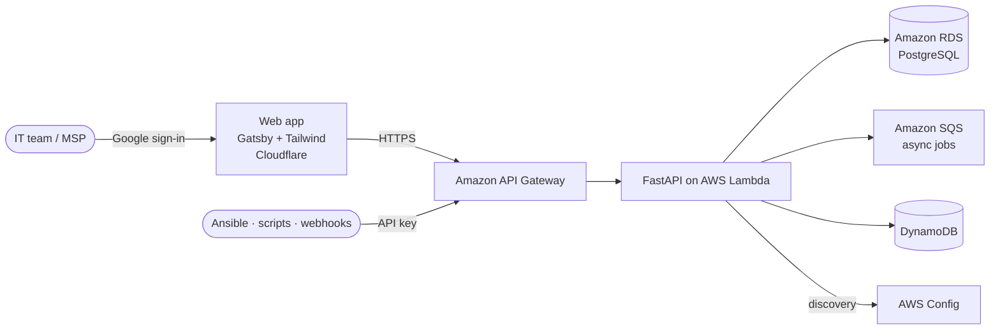

<!-- Organization profile README for github.com/syntaxroot-cc -->

  

<h1 align="center">SyntaxRoot</h1>

<h3 align="center">ITSM &amp; CMDB without the enterprise price tag</h3>

  A full IT service management and configuration management platform for <b>small-to-mid IT teams and MSPs</b> 
  who are priced out of tools like ServiceNow. Running in days, not quarters.

  
  
  

  
  
  
  

---

> [!IMPORTANT]
> **SyntaxRoot is invite-only right now.** There's no self-serve signup yet. Email **[hello@syntaxroot.cc](mailto:hello@syntaxroot.cc?subject=SyntaxRoot%20invitation%20request)** with your team size and what you track today, and we'll set up a walkthrough and send your organization an invitation.

---

## 📇 Contents

[Why SyntaxRoot](#-why-syntaxroot) · [Capabilities](#-capabilities) · [Platform](#%EF%B8%8F-platform--security) · [Integrations](#-integrations) · [Architecture](#%EF%B8%8F-architecture) · [Getting Access](#-getting-access) · [Open Source](#-open-source) · [About](#-about-thought-parameters)

---

## 🎯 Why SyntaxRoot

If your team has outgrown spreadsheets and shared inboxes for tracking incidents and assets, but a ServiceNow-scale deployment is out of reach on budget, headcount, or timeline, SyntaxRoot is built for that gap.

| | Spreadsheets &amp; shared inboxes | Enterprise ITSM suites | **SyntaxRoot** |
| :-- | :--: | :--: | :--: |
| Incident, problem &amp; change workflows | ❌ | ✅ | ✅ |
| CMDB with relationship mapping | ❌ | ✅ | ✅ |
| Automated cloud discovery | ❌ | ✅ | ✅ (AWS) |
| SLA tracking with business hours | ❌ | ✅ | ✅ |
| Multi-tenant for MSPs | ❌ | Varies | ✅ built in |
| Time to value | Immediate, but doesn't scale | Quarters | **Days** |
| Price | Free, until it isn't | Six-figure procurement | **Sized for lean teams** |

---

## 🧩 Capabilities

<table>
  <tr>
    <td width="33%" valign="top">
      <h4>🚨 Incident Management</h4>
      Track incidents from first alert to resolution. Templates, routing rules, assignment groups, automatic escalation, and linking to root-cause problems.
    </td>
    <td width="33%" valign="top">
      <h4>🔍 Problem Management</h4>
      Find the causes behind repeat incidents and record workarounds in a <b>Known Error Database</b> so the next occurrence is solved in minutes.
    </td>
    <td width="33%" valign="top">
      <h4>🔁 Change Management</h4>
      Change requests and templates, an approval inbox, and <b>CAB meetings</b>, with a full audit trail of who approved what and when.
    </td>
  </tr>
  <tr>
    <td width="33%" valign="top">
      <h4>🗂️ CMDB</h4>
      Configuration items, custom CI classes, and real relationship mapping, plus <b>automated AWS discovery</b> and staleness checks so the map stays accurate.
    </td>
    <td width="33%" valign="top">
      <h4>🛒 Service Catalog</h4>
      Publish orderable IT services, take service requests, and route them through approvers and approver groups automatically.
    </td>
    <td width="33%" valign="top">
      <h4>💼 Asset &amp; License Management</h4>
      Track hardware and software assets, allocate licenses, and flag compliance gaps before an audit does.
    </td>
  </tr>
  <tr>
    <td width="33%" valign="top">
      <h4>⏱️ SLA Tracking</h4>
      Response and resolution targets applied automatically, measured against each team's business hours, with at-risk tickets surfaced early.
    </td>
    <td width="33%" valign="top">
      <h4>📚 Knowledge Base</h4>
      Capture fixes and runbooks once. Article health checks flag stale content so your knowledge stays trustworthy.
    </td>
    <td width="33%" valign="top">
      <h4>🔔 Notifications &amp; Reporting</h4>
      Real-time and email notifications with per-user preferences, dashboards, and exportable reports for stakeholders.
    </td>
  </tr>
</table>

> [!NOTE]
> 🔎 **Search all 39 capabilities** by module: **[`data/features.csv`](https://github.com/syntaxroot-cc/.github/blob/main/data/features.csv)**

---

## 🛡️ Platform &amp; Security

| | |
| :-- | :-- |
| **Multi-tenant by design** | Each organization's members and data are isolated, which is what MSPs need to serve multiple clients from one platform. |
| **Invite-only membership** | Users join an organization only by invitation from an admin. |
| **Single sign-on** | Sign in with Google; no new passwords to manage. |
| **Role-based access** | Roles and permissions control who can view, edit, and approve. |
| **Tamper-evident audit log** | Every change is recorded with integrity verification, so the audit trail holds up to scrutiny. |
| **API keys** | Scoped keys for automation and integrations, separate from user sign-in. |

---

## 🔌 Integrations

| Integration | What it does |
| :-- | :-- |
| **REST API** | Versioned `/api/v1` API with API-key authentication for tickets, CIs, and more |
| **Webhooks** | Push SyntaxRoot events to your own systems in real time |
| **AWS Config discovery** | Discovers and reconciles AWS resources into the CMDB automatically |
| **Ansible collection** (`syntaxroot.cmdb`) | Populate the CMDB from Ansible facts, use the CMDB as a dynamic inventory, and alert on configuration drift |

---

## ⚙️ Architecture

| Layer | Technology |
| :-- | :-- |
| Frontend |     |
| API |     |
| Data |    |
| Delivery |   |

Serverless end to end: no servers to patch, and costs scale with use. Every environment is defined in Terraform and shipped through GitHub Actions.

---

## 🔑 Getting Access

  

SyntaxRoot is in **invite-only early access** while we onboard a small group of teams and shape the roadmap with them.

| Step | What happens |
| :--: | :-- |
| **1** | Email **[hello@syntaxroot.cc](mailto:hello@syntaxroot.cc?subject=SyntaxRoot%20invitation%20request)** or use **Request a Demo** on [syntaxroot.cc](https://syntaxroot.cc) |
| **2** | We run a walkthrough with your team, using your real incident, change, and asset workflows |
| **3** | We create your organization and send invitations to your admins |
| **4** | Your team signs in with Google at [syntaxroot.cc/login](https://syntaxroot.cc/login/) |

> [!NOTE]
> The SyntaxRoot product source code is private and proprietary. Membership in this GitHub organization is also by invitation only.

---

## 📦 Open Source

Alongside the product, we publish open-source Go tooling for infrastructure and release engineering:

| Repository | Description | License |
| :-- | :-- | :-- |
| **[gomnibus](https://github.com/syntaxroot-cc/gomnibus)** | A Go rewrite of Chef Omnibus: build self-contained, cross-platform installers (`.deb`, `.rpm`, `.pkg`, `.msi`) from a declarative YAML/HCL DSL | Apache-2.0 |
| **[gomnibus-software](https://github.com/syntaxroot-cc/gomnibus-software)** | Reusable software definitions for gomnibus | Apache-2.0 |
| **[gomnibus-gitlab](https://github.com/syntaxroot-cc/gomnibus-gitlab)** | A gomnibus port of omnibus-gitlab: build GitLab CE packages from YAML definitions | Apache-2.0 |
| **[grsync](https://github.com/syntaxroot-cc/grsync)** | A Go rewrite of rsync with delta transfer, SSH transport, daemon mode, and archive semantics | GPL-3.0 |

Found a security issue? Please follow our **[security policy](https://github.com/syntaxroot-cc/.github/blob/main/SECURITY.md)** instead of opening a public issue.

---

## 🏢 About Thought Parameters

  

SyntaxRoot is built and operated by **[Thought Parameters LLC](https://thoughtparameters.com)**, a remote-first software development and DevOps consultancy in Placentia, California.

| | |
| :-- | :-- |
| **Product lead** | [Jason Lee Miller](https://github.com/jasonmiller-cc), Founder &amp; CEO, Thought Parameters |
| **Engineering** | Oluwatobi Ogundimu |
| **Company** | [thoughtparameters.com](https://thoughtparameters.com) · [GitHub](https://github.com/ThoughtParameters) · 1 (888) 875-1399 |

> **Need a team that can design, build, and operate software like this?** Thought Parameters builds custom platforms for clients too. [Let's talk.](https://thoughtparameters.com)

  
  
  
  
  

---

  © 2026 Thought Parameters LLC · SyntaxRoot is a product of Thought Parameters LLC · <a href="https://syntaxroot.cc">syntaxroot.cc</a> 
  Images: <a href="https://unsplash.com/@winstonchen?utm_source=syntaxroot_github&utm_medium=referral">Winston Chen</a> and <a href="https://unsplash.com/@zoshuacolah?utm_source=syntaxroot_github&utm_medium=referral">Zoshua Colah</a> on <a href="https://unsplash.com/?utm_source=syntaxroot_github&utm_medium=referral">Unsplash</a>

